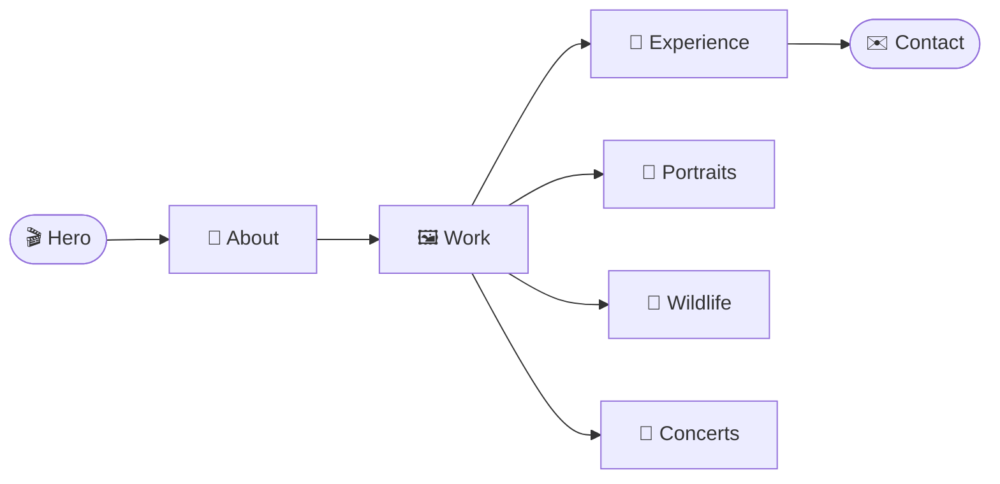

<!-- Header -->
<p align="center">
  
</p>

<!-- Typing SVG -->
<p align="center">
  <a href="https://mohit-gupta-portfolio-blue.vercel.app">
    
  </a>
</p>

<!-- Links -->
<p align="center">
  <a href="https://mohit-gupta-portfolio-blue.vercel.app"></a>
  <a href="https://github.com/Sumit0802-afk/mohit-gupta-portfolio"></a>
  <a href="#-quick_start"></a>
  <a href="#-contact"></a>
</p>

<p align="center">
  
  
  
  
  
  
</p>

<br>

<!-- At a glance -->
<table align="center">
  <tr>
    <td align="center" width="33%" valign="top">
      <h3>🧑</h3>
      <b>Portraits</b><br>
      <sub>People, in the studio and outdoors</sub>
    </td>
    <td align="center" width="33%" valign="top">
      <h3>🦌</h3>
      <b>Wildlife</b><br>
      <sub>Animals and the places they live</sub>
    </td>
    <td align="center" width="33%" valign="top">
      <h3>🎤</h3>
      <b>Concerts</b><br>
      <sub>Stages, crowds and events, in photos and film</sub>
    </td>
  </tr>
</table>

<br>

<blockquote align="center">
  <b>Creative visual storyteller capturing people, places, moments and experiences through photography and film.</b>
</blockquote>

<!-- How the site moves -->


<br>

<!-- About -->
## `> about.ts`

```typescript
const portfolio = {
    for: "Mohit Gupta",
    role: "Photographer & Videographer",
    location: "Faridabad, Haryana, India",
    liveSite: "https://mohit-gupta-portfolio-blue.vercel.app",
    galleries: ["Portraits", "Wildlife", "Concerts"],
    sections: ["Hero", "About", "Work", "Experience", "Leadership", "Skills", "Tools", "Education", "Contact"],
    stack: {
        framework: ["Next.js 16 (App Router)", "React 19", "TypeScript"],
        styling: ["Tailwind CSS 4", "design tokens in CSS"],
        motion: ["GSAP + ScrollTrigger", "Framer Motion", "Lenis smooth scroll"],
        icons: ["Lucide"]
    },
    media: "all of it Mohit's own work"
};
```

<p align="center">
  
</p>

<!-- Tech Stack -->
## `> tech_stack`

<p align="center">
  <a href="https://skillicons.dev">
    
  </a>
</p>

<p align="center">
  
</p>

<!-- Features -->
## `> features`

<table align="center">
  <tr>
    <td width="33%" valign="top">
      🎬 &nbsp;<b>Cinematic hero</b><br>
      <sub>A full-screen frame with text that rolls into place</sub>
    </td>
    <td width="33%" valign="top">
      💬 &nbsp;<b>Cinematic quote</b><br>
      <sub>A full-width line between the sections</sub>
    </td>
    <td width="33%" valign="top">
      🌊 &nbsp;<b>Smooth scroll</b><br>
      <sub>Lenis scrolling with parallax pictures</sub>
    </td>
  </tr>
  <tr>
    <td valign="top">
      🧱 &nbsp;<b>Masonry galleries</b><br>
      <sub>Three galleries, each on its own page</sub>
    </td>
    <td valign="top">
      🔍 &nbsp;<b>Lightbox</b><br>
      <sub>Open any photo or video full size</sub>
    </td>
    <td valign="top">
      ↔️ &nbsp;<b>Horizontal showcase</b><br>
      <sub>Work that slides sideways as you scroll</sub>
    </td>
  </tr>
  <tr>
    <td valign="top">
      🧲 &nbsp;<b>Magnetic buttons</b><br>
      <sub>Buttons that lean toward the pointer</sub>
    </td>
    <td valign="top">
      ✨ &nbsp;<b>Reveals and transitions</b><br>
      <sub>Pictures unveil on scroll; pages change with a transition</sub>
    </td>
    <td valign="top">
      📱 &nbsp;<b>Phone layout</b><br>
      <sub>A mobile menu and layouts for small screens</sub>
    </td>
  </tr>
</table>

<details>
<summary><b>What is on the page, in detail</b></summary>
<br>

```typescript
const home = {
    hero: "name, role and a full-screen frame",
    about: "a short introduction",
    work: "the three galleries, as cards and a horizontal showcase",
    experience: "Photography & Videography Intern at Netts Mobility",
    leadership: "roles in student clubs and associations",
    skills: ["Photography", "Videography", "Tools & Software", "Soft Skills"],
    tools: ["Lightroom", "Photoshop", "Premiere Pro", "DaVinci Resolve", "Canva", "CapCut"],
    education: "B.Tech, Computer Science & Engineering, VIT-AP University",
    contact: ["email", "phone", "LinkedIn", "Instagram"]
};

const galleries = {
    routes: ["/portraits", "/wildlife", "/concerts"],
    layout: "masonry, with a lightbox for photos and videos",
    source: "Mohit's Google Drive folders, downloaded by a script"
};
```

</details>

<p align="center">
  
</p>

<!-- Quick Start -->
## `> quick_start`

**You need:** Node.js 20 or newer and npm.

```bash
# 1. clone
git clone https://github.com/Sumit0802-afk/mohit-gupta-portfolio.git
cd mohit-gupta-portfolio/mohit-gupta-portfolio

# 2. install and run  ->  http://localhost:3000
npm install
npm run dev
```

The site lives in the inner `mohit-gupta-portfolio` folder; run every command from there.

<p align="center">
  
</p>

<!-- Media -->
## `> media`

All photos and videos are Mohit's own work, pulled from three Google Drive folders.

```bash
node scripts/fetch-drive.mjs              # photos and videos
node scripts/fetch-drive.mjs --no-video   # photos only
```

| Step | What happens |
| :--- | :--- |
| **1. Read** | The script reads `scripts/drive-manifest.json`: a Drive file id and name for each gallery |
| **2. Photos** | Saved as web-size JPEGs in `public/images/<gallery>/` |
| **3. Videos** | Saved in `public/videos/<gallery>/` |
| **4. Index** | Writes `src/data/driveMedia.json`, the list the site reads |

Files already downloaded are skipped, so the script is safe to run again.

**To add new work:** upload it to the Drive folder, add its id and file name to the manifest, and run the script again.
Which frame is used for the hero, the about picture and the gallery covers is set by file name in `src/data/portfolio.ts`.

<p align="center">
  
</p>

<!-- Architecture -->
## `> architecture`

```
mohit-gupta-portfolio/
├── src/
│   ├── app/                   home page, /portraits, /wildlife, /concerts
│   ├── components/            one folder per section: hero · portfolio · gallery · about · contact …
│   ├── animations/            GSAP timelines and Framer Motion variants
│   ├── hooks/                 scroll progress, parallax, mouse position, media queries
│   ├── data/                  all the words and picture choices (the resume is the source)
│   ├── lib/                   GSAP setup, the three Drive folders, helpers
│   └── styles/                design tokens, type, animation and layout CSS
├── scripts/                   the Drive download script and its manifest
└── public/                    images, videos, fonts and icons
```

**To change the words on the site,** edit the files in `src/data`; no component needs to change.

<p align="center">
  
</p>

<!-- Deploy -->
## `> deploy`

```yaml
host: Vercel
rootDirectory: mohit-gupta-portfolio
frameworkPreset: Next.js
build: npm run build
env: none needed
```

<p align="center">
  
</p>

<!-- Contact -->
## `> contact`

<h3 align="center">Mohit Gupta</h3>

<p align="center">
  Available for photography, videography, creative collaborations and visual storytelling.
</p>

<p align="center">
  <a href="https://www.linkedin.com/in/mohit-gupta-8858a7234/"></a>
  <a href="https://www.instagram.com/_mohit_gupta21"></a>
  <a href="https://mohit-gupta-portfolio-blue.vercel.app/#contact"></a>
</p>

<p align="center">
  
</p>

<!-- Built by -->
## `> built_by`

<p align="center">
  <a href="https://github.com/Sumit0802-afk">
    
  </a>
</p>

<h3 align="center">Sumit Bhamu</h3>

<p align="center">
  Designed and built this site for Mohit Gupta.
</p>

<p align="center">
  &nbsp;
  &nbsp;
  &nbsp;
  
</p>

<br>

<table align="center">
  <tr>
    <td align="center" width="210">
      <sub><b>COMMITS</b></sub><br><br>
      
    </td>
    <td align="center" width="210">
      <sub><b>LAST&nbsp;COMMIT</b></sub><br><br>
      
    </td>
    <td align="center" width="210">
      <sub><b>TYPESCRIPT</b></sub><br><br>
      
    </td>
    <td align="center" width="210">
      <sub><b>CODE&nbsp;SIZE</b></sub><br><br>
      
    </td>
  </tr>
</table>

<p align="center">
  
</p>

<p align="center">
  
</p>

<p align="center">
  <a href="https://mohit-gupta-portfolio-blue.vercel.app"></a>
  <a href="https://github.com/Sumit0802-afk"></a>
  <a href="https://github.com/Sumit0802-afk/mohit-gupta-portfolio/stargazers"></a>
</p>

<!-- Footer -->
<p align="center">
  
</p>
